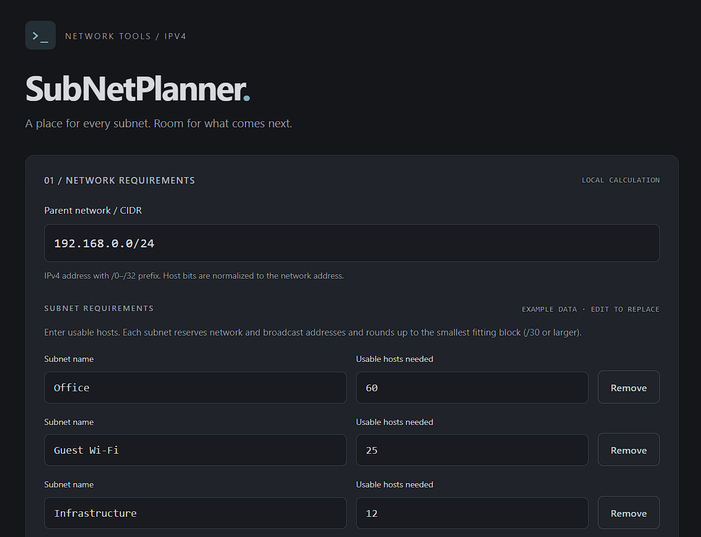

# SubNetPlanner

[](https://github.com/JohnB-LWF/SubNetPlanner)
[](https://developer.mozilla.org/en-US/docs/Web/JavaScript)
[](https://nodejs.org/)
[](https://github.com/JohnB-LWF/SubNetPlanner)

A dependency-free, offline IPv4 VLSM planner and companion to [SubNetCalc](https://github.com/JohnB-LWF/SubNetCalc). Plan named subnet requirements from a parent network and get address allocations, utilization, and unallocated ranges—all in your browser.



## Contents

- [Use it](#use-it)
- [How it works](#how-it-works)
- [Tests](#tests)

## Use it

[Open the live app](https://subnetplanner.onrender.com/).

Open `index.html` directly in a browser. No install, build, account, backend, external assets, or network requests are needed. Keep `index.html`, `styles.css`, and the three JavaScript files together.

Enter a parent CIDR and named usable-host requirements, then choose **Plan subnets**. Example data is provided for replacement. Input changes hide previous results until recalculation. All information stays in the page; reloading restores the example.

## How it works

- Each requirement receives the smallest power-of-two block that fits the requested usable hosts plus network and broadcast addresses, never smaller than `/30`.
- Larger requirements are allocated first; ties follow input order. Results are displayed in the original input order.
- Parent networks are normalized to their network address. If all requirements do not fit, the planner reports insufficient capacity instead of returning a partial plan.
- The overview shows address utilization, assigned and remaining capacity, subnet details, and unallocated ranges.
- IPv4 helpers and styling are adapted from the local SubNetCalc companion; shared `/31` and `/32` semantics remain intact.

Calculations describe address arithmetic, not real-world availability or reachability.

## Tests

With Node.js installed:

```sh
node --test tests/*.test.cjs
```

`ipv4.js` holds the shared address helpers; `planner.js` contains browser-independent planning logic; `app.js` manages form validation and rendering. No runtime dependencies.
